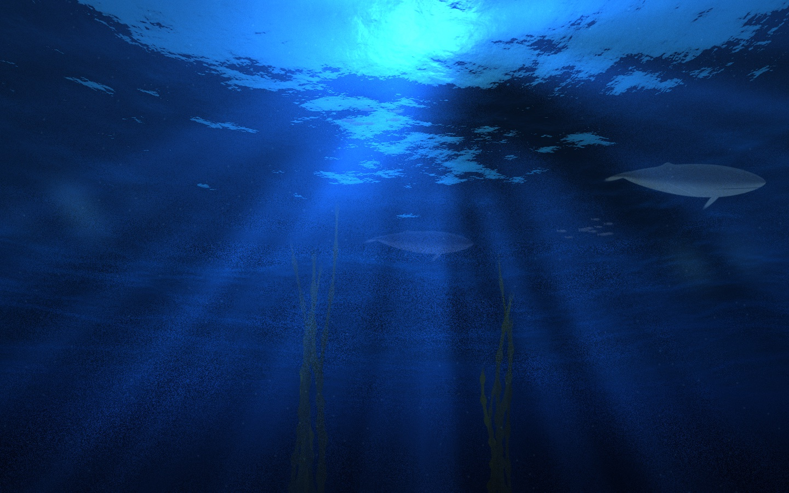

# EchomereScene

The cove scene for macOS (issue #7): what every screen in a cove shows, drawn natively with Metal.



## Modules

- **CoveScene**: plain Swift, no Metal. Turns a cove's seed, its visitors, its echoes and the time into a
  `SceneFrame`: where every whale, fish and kelp stalk is at that moment. Every screen in a cove computes the
  same frame, so they all show the same picture without anything being streamed (ADR 0005).
- **CoveSceneRenderer**: draws a `SceneFrame` with Metal in one full-screen pass, into a `CAMetalLayer` or into
  an image. The shader is compiled at runtime, so the package builds without Xcode.
- **ScenePreview**: a window for looking at the scene, and a snapshot tool.
- **SceneChecks**: behaviour checks at the scene seam.

The screensaver shell (#9) and the creator's overlay (#8) build on these modules.

## Use

Requires macOS 14 or later and the Swift toolchain (the Command Line Tools are enough).

```sh
swift run SceneChecks                        # behaviour checks; exits 1 on failure
swift run ScenePreview                       # a window; space shows another cove, Esc quits
swift run ScenePreview --speed 20            # time runs 20 times faster
swift run ScenePreview --snapshot cove.png --seed 7 --at 1794000500 --size 1440x900
swift run ScenePreview --view above          # the same sea from above, to check the waves
```

Other options: `--seed N`, `--whales N` (up to 6), `--echoes N`, `--fps N` (default 15), `--scale X`
(render resolution relative to the screen, default 0.5).

## Energy

The scene draws at 15 frames per second and at half the screen's resolution, and the preview stops drawing
whenever its window can't be seen. Whether a `.saver` really stops when dismissed is measured in #3.

## Tests

The checks are a plain executable for now, because XCTest and Swift Testing need a full Xcode installation.
They can move to a test target once Xcode is available.
